# TOI — Telescope Operator Interface

Desktop GUI for the OCM telescopes (wk06, zb08, jk15): mount, dome, instruments, plans, FITS preview and site
conditions. It talks to the observatory over NATS (TIC / ocabox). Changes: [Misc/changelog.txt](Misc/changelog.txt).

**Contents:** [Start](#start) · [Screen layout](#screen-layout) · [Observation window](#observation-window) ·
[Mount](#mount) · [Instrument](#instrument) · [Plan](#plan) · [FITS](#fits) · [Aux tabs](#aux-tabs) ·
[Alerts, events, sounds](#alerts-events-sounds) · [Configuration](#configuration) · [Installation](#installation) ·
[FAQ](#faq)

## Start
```
cd ~/src/TOI/
poetry run toi            # installed with poetry (see Installation), or: ./toi.py
```
TOI reads `toi_config.yaml` from the current directory and connects to NATS first — without NATS it exits.

- **Telescope:** click its row in the telescope table (observation window). All panels show the active one.
- **Control:** only the station that has control of a telescope can command it (**Take Control** in the Sky panel).
  Without it buttons answer "U don't have control"; viewing works everywhere.
- **Observers of the night:** a window asks once a day (after `toi.observers_reset_ut`, default 15 UT); the choice is
  shared by all stations (ASCII names - meant for the FITS `OBSERVER` keyword). The **Admin** box there enables admin
  mode on this station.
- **Daily checklist:** Aux → Tasks.
- **Quit:** EXIT in the Sky panel (saves the panel layout).

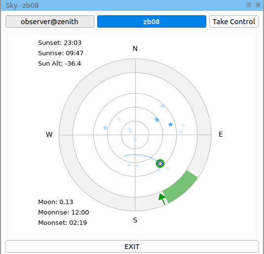

## Screen layout
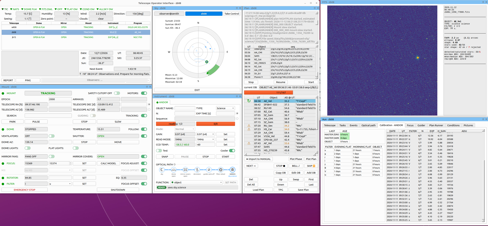

The observation window is the main window; Mount, Instrument, Sky, Plan, FITS and Aux are panels in it. Drag a panel
by its title to dock it elsewhere, stack it as a tab or float it to another monitor. The layout is saved per screen
setup. **⚙ menu** (bottom right of the observation window): bring up any panel or Aux tab, theme (day / night / …),
FITS options, plan log length, **Reset layout**.

## Observation window
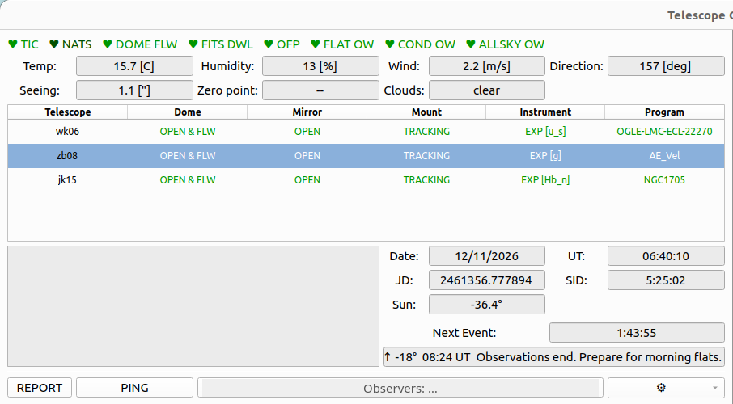

- **Status lamps** (green = alive, red = no answer; hover for details): TIC, NATS, and for the active telescope DOME FLW
  (dome follower), FITS DWL (downloader), OFP (pipeline); FLAT OW, COND OW, ALLSKY OW (overwatches).
- **Conditions:** temperature, humidity, wind, direction (Davis); site seeing and zero point (all telescopes, last
  30 min); clouds (allsky). Colour: green ok, yellow / orange warning, red limit. A dot with minutes = how long a
  weather restriction is still held.
- **Telescope table:** dome, mirror covers, mount, instrument and program of every telescope; icons: joystick = you
  have control, safety cutoff, program error, fans, lamps, wind, rain, humidity, frost, clouds (hover for the reason).
  Click a row to make the telescope active.
- **Messages** (left box): operator messages of the whole observatory — weather, clouds, seeing and system alarms,
  events, PING — from TOI stations and the overwatches, coloured by kind. The planrunner / pipeline log is in the Plan
  panel.
- **Time:** date, UT, JD, sidereal time, Sun altitude; **Next Event** = countdown to the nearest event and its trigger
  (`Sun ↑ -18°`, `UT`, `⏱ 10 min`).
- **REPORT** — diagnostic dump of TOI's state (for bug reports); **PING** — ping all stations and overwatches, test the
  alarm sounds; **Observers** — the observers window.

## Mount
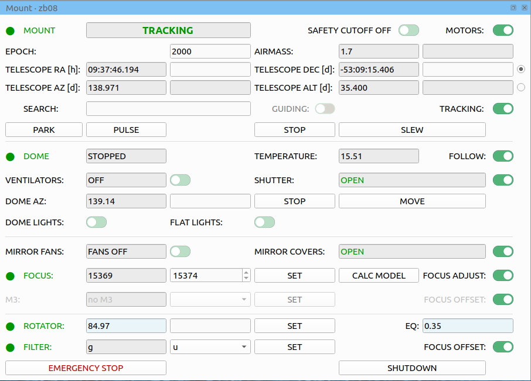

- **MOUNT:** coordinates, target (SEARCH in the object catalogue), SLEW, STOP, PARK, TRACKING, MOTORS, SAFETY CUTOFF.
- **PULSE:** small offsets of the mount (RA / Dec arcsec) and rotator; from the Guider tab the same window moves the
  star in guider pixels.

  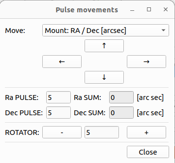
- **GUIDING:** on = the guider guides (Find star if needed, then GUIDE); off = the guider OFF. Grey without a guider.
- **DOME:** azimuth, MOVE / STOP, shutter, FOLLOW (dome follower), ventilators, dome and flat lights.
- **Mirror** fans and covers.
- **FOCUS:** position, SET; CALC MODEL puts the focus of the temperature model into the field (SET then moves). **FOCUS ADJUST** keeps the focus right while
  the temperature changes — see [FAQ](#focus-adjust).
- **M3** (jk15): port andor / beso. **FOCUS OFFSET** on → after SET M3 the focus moves by the port offset.
- **ROTATOR:** mechanical angle (SET, limits ±160°) and EQ angle.
- **FILTER:** SET; **FOCUS OFFSET** on → the focus follows the filter offset (all 0 today).
- **EMERGENCY STOP** (TIC stop, no confirmation) and **SHUTDOWN** (dome follower off, telescope parked).

## Instrument
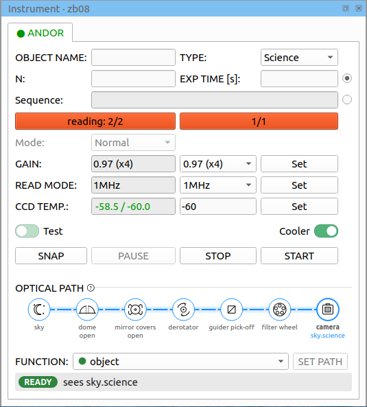

One tab per science instrument of the telescope (Andor / CMOS camera, BESO spectrograph).
- Manual exposures: object name, type, N × exposure time or a sequence (`N/filter/exp,…`), START / STOP / SNAP.
  Bars: current exposure and number of frames.
- Gain, read mode, CCD temperature / set point (red = warmer than the operating temperature) and Cooler.
- **Optical path** strip (details in Aux → Optical path).

## Plan
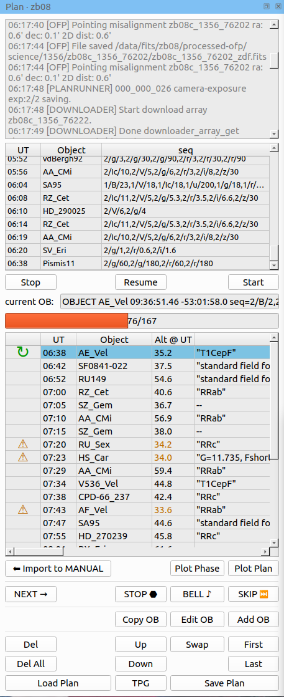

- Top: planrunner log and the done OBs; **Start / Stop / Resume** the plan, current OB and progress.
- Table: planned UT, object, altitude at that time, comment. Column 0: ↻ current OB, red Moon = too close to the Moon,
  ⚠ orange = low, red = too high (warnings only; hover for the reason).
- **NEXT** = run the selected OB next; **SKIP** = skip it (click again to undo); **STOP / BELL** = insert a stop / bell.
- Edit: Add / Edit / Copy OB, Del, Up / Down, First / Last, Swap, Del All. **Import to MANUAL** copies the selected OB
  to the Mount and Instrument fields.
- **Load Plan / Save Plan** (starts in `/data/misc/`), **TPG** = generate a night plan (sky flats evening / morning,
  "SKYFLATS only").
- **Plot Plan** — altitude of the objects over the night; **Plot Phase** — light curve of a periodic target.

  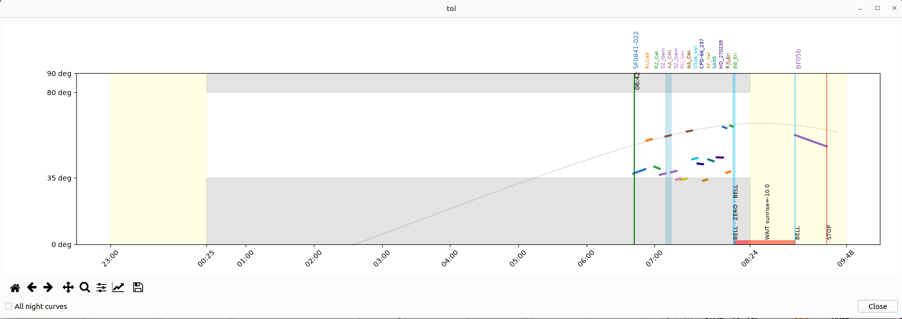
  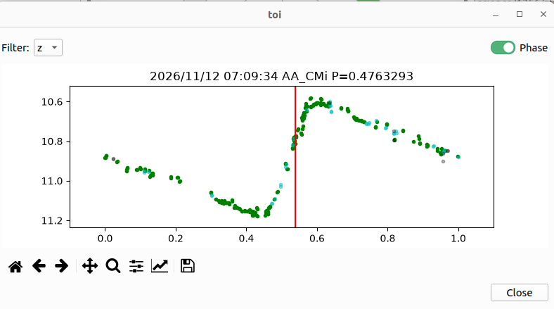

## FITS
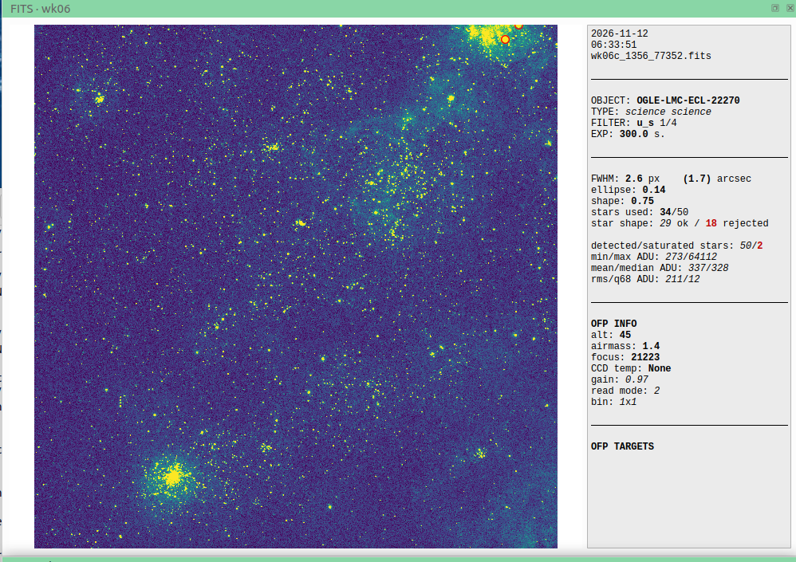

Last frame of the active telescope with stars measured by FFS (science, snap and focus frames only).
- Panel: FWHM (px and arcsec), ellipticity, shape, stars used, star shape ok / rejected, saturated stars, ADU stats,
  OFP info (altitude, airmass, focus, CCD temp…) and OFP targets.
- Drawn on the image: saturated stars (red circles), satellite trails (red bands + WARNING), PSF pattern (whiskers
  through elongated stars + centre), trailed stars WARNING.
- ⚙ menu: FITS display (full or binned image, what is drawn), FITS colormap, FITS scale (median + mad, ZScale,
  mean ± std).

## Aux tabs
Tabs come up by themselves: M3 moved → Optical path, flat OB → Calibration, focus OB → Focus, seeing / zero point
alert → Conditions, event with a picture → Pictures.

| Tab | |
|---|---|
| **Telescope** | the telescope's page and changelog from the OCA manual |
| **Tasks** | daily checklist (per telescope or for the observatory, shared, reset daily) and observation requests (ocm-plans; double click = GitHub issue) |
| **Events** | timed messages with sound and picture — see [Alerts, events, sounds](#alerts-events-sounds) |
| **Optical path** | where the light goes: dome, covers, M3, derotator, filter wheel, instruments; unknown elements red |
| **Calibration** | age of master zero / dark and of the last flats and objects per filter (red = old); flats log |
| **Focus** | autofocus: method, camera, filter, central value, step, steps → FIND FOCUS; curve and RESULT; **SET** moves the focuser |
| **Guider** | jk15 BESO guider: frame (left click = star to guide on, right click = mark), OFF / MONITOR / GUIDE, move star to fiber, exposure / gain / search radius, drift plots, journal |
| **Plan Runner** | raw planrunner progress messages of the active telescope (for debugging) |
| **Conditions** | FWHM or zero point of all telescopes through the night |
| **Pictures** | event pictures and the picture of the theme |

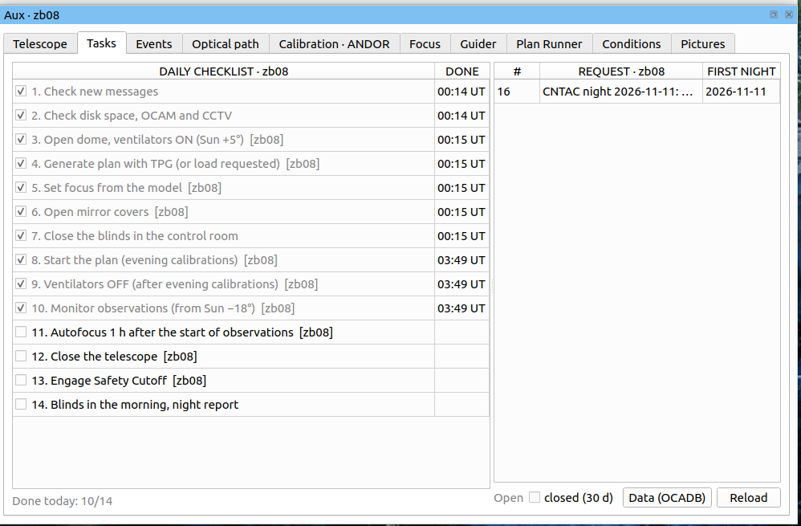
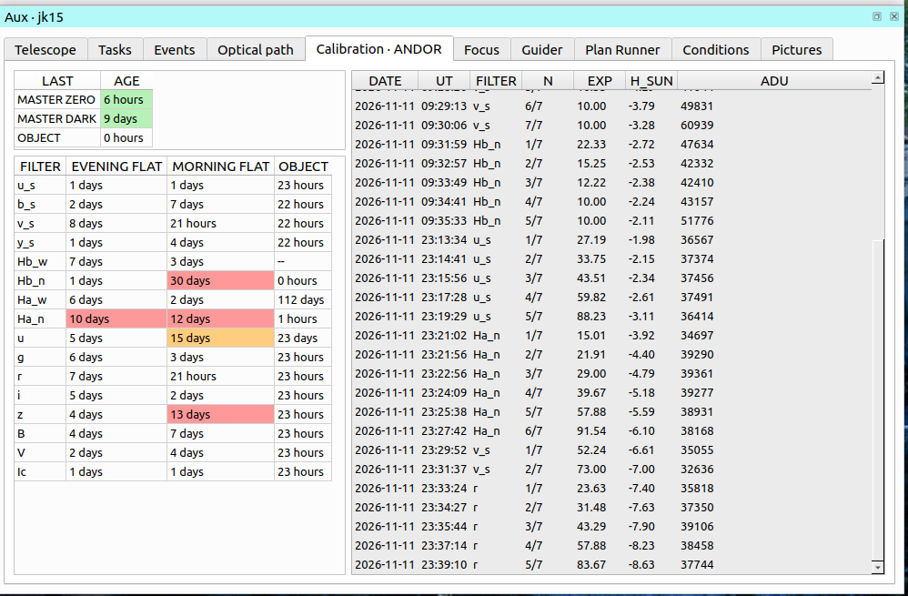
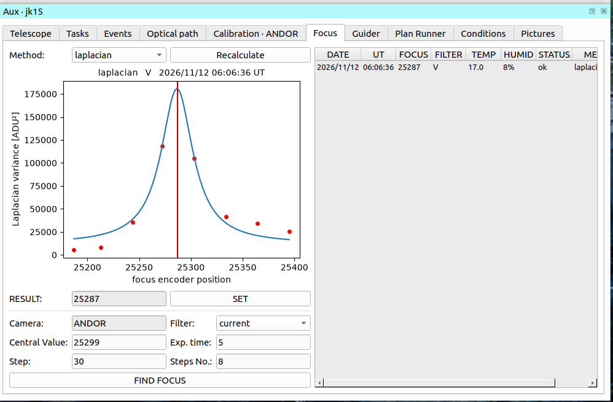
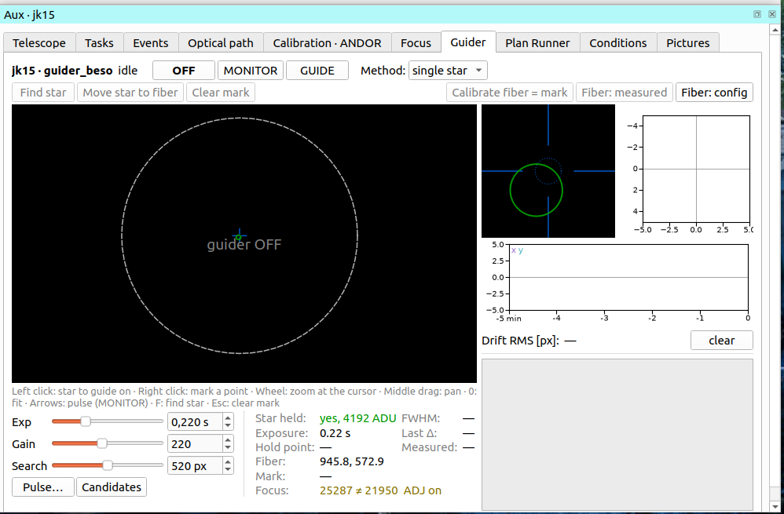
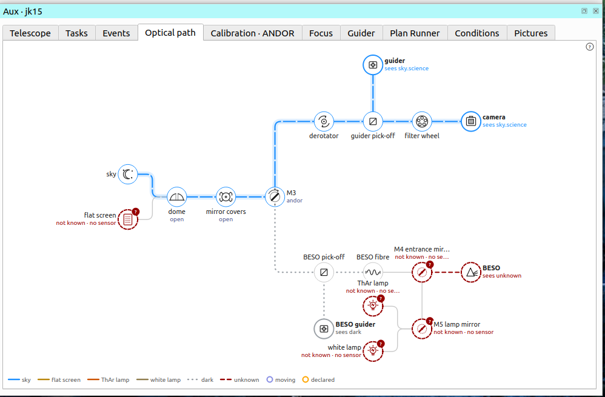
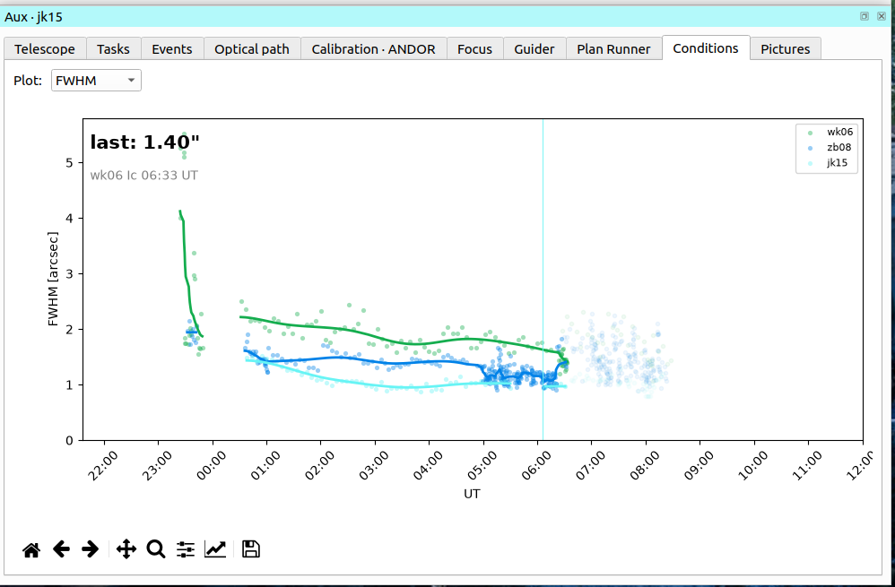

## Alerts, events, sounds
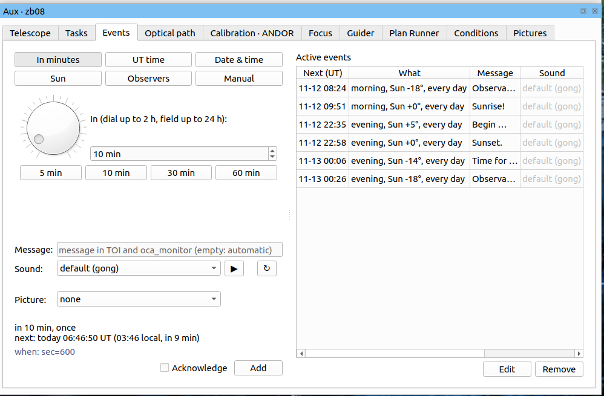

- **Events** (Aux → Events, run by conditions_overwatch for all stations): choose when — in minutes, UT time, date &
  time, Sun altitude, at the next save of the observers, or by hand — then message, sound (▶ listen) and picture, Add.
  Sun / UT / observers events can repeat every day. **Acknowledge** = the event also pops up the window below.
  Edit / Remove on the right. Anybody can add events.
- **Alerts to acknowledge:** problems that need a person (e.g. water level) and events with Acknowledge pop up in the
  "To acknowledge" window on every station until somebody presses **Acknowledge**; "Later" hides it until the next
  save of the observers. Problems are red, events show their picture.
- **Sounds** play on oca_monitor (control room); PING tests them.
- **Admin mode** (observers window): secret events (surprises, hidden from others) and the special sounds / pictures.

## Configuration
- **TIC / ocabox config** (telescopes, instruments, filters, filter focus offsets): read only, from NATS.
- **`toi_config.yaml`**, per telescope: data paths, `focus_step`, `focus_method(s)`, `focus_port_offset` (M3 port
  focus offsets, e.g. jk15 `{andor: 0, beso: -3387}`); under `toi:` — telescopes, NATS, `observers_reset_ut`,
  `oca_manual_url`, `requests_json`, `alive_subjects`, `conditions_subjects`, `events` (subjects, sound / picture folders).
- `observers.yaml` — observers list (ASCII only, it goes to FITS); `checklist.yaml` — daily checklist.

## Installation
Needs [poetry](https://python-poetry.org/docs/#installation) and Python 3.11–3.14.
```
git clone https://github.com/astromg/TOI.git
cd TOI
poetry install
toi
```

## FAQ

**A panel disappeared / the layout is a mess.** ⚙ menu → the panel's name brings it back; ⚙ → Reset layout returns to
the default. The layout is saved when TOI quits by EXIT or the window's ✕ (not by Ctrl+C).

**"U don't have control".** Another station controls the telescope. Take Control in the Sky panel.

<a id="focus-adjust"></a>**How does FOCUS ADJUST work?** Every time TOI sets the focus (SET, autofocus, a focus offset,
or adjust itself) it remembers the position and the Davis temperature / humidity as a reference. Adjust then moves
the focuser to `reference + model(T, H now) − model(T, H at the reference)` when this differs by more than 5 steps —
never during an exposure or an autofocus. A focus set by hand (also a deliberate defocus) is kept and only follows
the temperature. The switch is shared by all stations; the tooltip of the focus field shows the reference and the
target. If another program moves the focuser without telling TOI, adjust brings it back.

**What do the FOCUS OFFSET switches do?** M3 row: after SET M3 from this station, when M3 arrives, the focus moves by the
difference of the port offsets (`focus_port_offset`; jk15 Andor → BESO −3387). Filter row: the same with the filter
offsets of the TIC config (all 0 today, so nothing moves). Both wait for the end of an exposure and are logged.
Only the station that pressed SET moves the focus; M3 or filter changes made by the plan get no offset from TOI.

**Why no stars or FWHM on a flat / zero / dark?** FFS runs only on science, snap and focus frames.

**The observers window keeps coming back.** It asks until somebody saves the observers after the daily reset
(`observers_reset_ut`). "Later" postpones it by 30 min; "Only this TOI" sets them for this station only.

**Why ASCII names for observers?** They are meant for the FITS `OBSERVER` keyword, which allows ASCII only.

**An event did not sound.** Sounds play on oca_monitor, not in TOI. Check that oca_monitor runs and conditions_overwatch is
alive (COND OW lamp).
